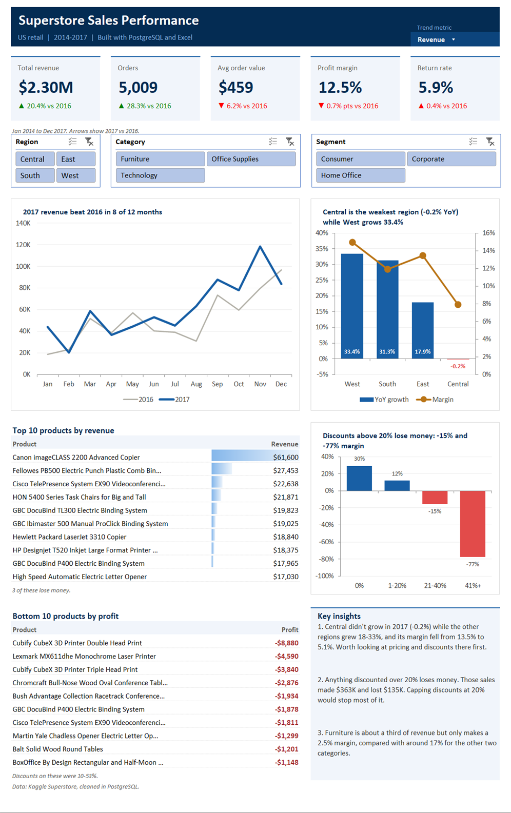

# Superstore sales dashboard

The question I wanted to answer: which products and regions are driving growth, and which ones are slipping?

I used the Kaggle Superstore dataset (US orders, 2014 to 2017). I loaded and cleaned it in PostgreSQL, then built the dashboard in Excel.

## Findings

1. Central is the only region that didn't grow in 2017 (-0.2%, while the others grew 18-33%). Its margin also dropped from 13.5% to 5.1% that year.
2. Discounts over 20% lose money. Those sales made $363K in revenue and lost $135K. At 41% and above, the store loses about 77 cents on every dollar.
3. Furniture is almost a third of revenue but only makes a 2.5% margin. Technology and Office Supplies both make around 17%.

## Numbers

| KPI | 2014-2017 | 2017 vs 2016 |
|---|---|---|
| Revenue | $2.30M | +20.4% |
| Orders | 5,009 | +28.3% |
| Avg order value | $459 | -6.2% |
| Profit margin | 12.5% | -0.7 pts |
| Return rate | 5.9% | +0.4 pts |

Revenue went up because there were more orders. The average order actually got smaller.

## Data preparation

Here's every step from the raw file to the data the dashboard uses.

### 1. Getting the files ready

1. Downloaded `Sample - Superstore.csv` from Kaggle: 9,994 rows and 21 columns, one row per product line in an order.
2. The file is saved in Latin-1 encoding, not UTF-8, so some characters came out garbled. I re-saved it as UTF-8 (`data/raw/superstore_orders.csv`).
3. The Kaggle version has no returns data, so I couldn't calculate a return rate from it. The original Superstore Excel file has a Returns sheet with 296 returned orders, so I exported that sheet to `data/raw/superstore_returns.csv` (columns: `returned`, `order_id`).
4. I copied both CSVs to `C:\Users\Public\superstore\`, because the PostgreSQL service can't read files in my Downloads folder.

### 2. First look in Excel

5. Opened the CSV in Excel with Power Query to get a feel for it: 9,994 rows, 4 regions, 3 categories, orders from 3 Jan 2014 to 30 Dec 2017.
6. `MIN(Order Date)` returned 0, which showed that Order Date and Ship Date had loaded as text, not dates. The file writes dates as month/day/year (US style) and my PC uses day/month/year, so Excel couldn't read them. I fixed this in Power Query with Change Type > Using Locale > English (United States).
7. Made a couple of quick pivots by region and category to check the totals ($2,297,201 revenue, $286,398 profit) and spot early patterns. Furniture's 2.5% margin showed up here first.

### 3. Loading into PostgreSQL (`sql/01_load.sql`)

8. Created an `orders` table with proper types: `DATE` for the two dates, `NUMERIC` for sales, discount and profit, `INT` for quantity and row ID, and `TEXT` for everything else. Postal code is `TEXT` on purpose, since it's an ID, not a number.
9. Created a `returns` table (`returned`, `order_id`).
10. Ran `SET datestyle = 'ISO, MDY'` so Postgres reads the dates as month/day/year. This is the same date problem as in Excel.
11. Loaded both files with `COPY`. Result: 9,994 order rows and 296 return rows.

### 4. Data quality checks (`sql/02_data_quality.sql`)

| Check | Result | What I did |
|---|---|---|
| Missing values in key columns | 0 | Nothing needed |
| Exact duplicate rows | 1 (order US-2014-150119, same chair twice) | Kept it. I can't prove it's an error, and it's worth $281, so it doesn't change any result |
| Rows vs orders | 9,994 rows, 5,009 orders | Orders are counted as distinct order IDs, never as rows |
| Customers / products | 793 / 1,862 | Just for context |
| Orders shipped before they were placed | 0 | Nothing needed |
| Zero or negative sales | 0 | Nothing needed |
| Discounts outside 0-100% | 0 | Nothing needed |
| Loss-making rows | 1,871 | Real data, not an error. This led to the discount analysis |
| Postal codes missing a leading zero | 51 (e.g. 5408 instead of 05408) | Fixed in the clean view |
| Returns that don't match an order | 0 | All 296 returns join cleanly |

### 5. Clean view (`sql/03_clean_view.sql`)

12. Built one view, `orders_clean`, for all the analysis:
    - Dropped `country`, because every row is United States
    - Added `order_year` and `order_month` (first day of the month) for the trend and YoY analysis
    - Added `days_to_ship` (ship date minus order date)
    - Fixed postal codes with `LPAD(postal_code, 5, '0')`
    - Rounded sales and profit to 2 decimal places (the raw file has up to 4)
    - Added `is_returned` (1 or 0) with a `LEFT JOIN` to the returns table
    - Added `order_count`, which is 1 on the first row of each order and 0 on the rest (using `ROW_NUMBER()`). Excel pivots can't easily count distinct values, so adding up this column gives the correct number of orders. `returned_order_count` works the same way for returned orders.
13. Checked the view still has 9,994 rows, and that `order_count` adds up to 5,009 and `returned_order_count` to 296.

### 6. Analysis queries (`sql/04` to `sql/11`)

14. Calculated the 5 KPIs, KPIs by year with YoY growth, region and category growth from 2016 to 2017, the monthly trend, the top 10 products by revenue, the bottom 10 by profit, and margin by discount band.

### 7. Into Excel

15. Exported the view with `sql/12_export_for_excel.sql` to `data/clean/orders_clean.csv` (9,994 rows, 26 columns), then loaded it into Excel as a table called `orders_clean`. The dates are ISO format (YYYY-MM-DD) this time, so there was no locale problem.
16. Added two calculated columns to the table:
    - `month_name` = `TEXT(order_date, "mmm")`, so the trend chart can compare months across years
    - `discount_band` = a nested `IF` that groups discount into 0%, 1-20%, 21-40% and 41%+
17. Cross-checked the Excel totals against SQL: revenue, orders, margin and return rate all match.

### Known issue

278 product names contain non-breaking spaces (a hidden character that looks like a normal space). They don't affect any totals or rankings, so I left them. If I took this further, I'd clean them in the view with `REPLACE(product_name, CHR(160), ' ')`.

## Excel

The workbook goes Data > Pivots > Calc > Dashboard. The pivots summarise the clean data, the Calc sheet pulls the numbers out with GETPIVOTDATA, and the Dashboard sheet only displays them. I used Excel 2019, so there's no UNIQUE, FILTER or XLOOKUP anywhere.

Open `superstore_dashboard.xlsx` and start on the Dashboard tab. There's also a PDF in `docs/`.

### Sheets

| Sheet | What's on it |
|---|---|
| Dashboard | KPI cards, slicers, charts, top and bottom 10 tables, insights |
| Calc | All the formulas behind the dashboard |
| Pivots | 6 pivot tables that feed Calc |
| Data | The clean table from PostgreSQL (`orders_clean`) |
| Exploration | My first pivots by region and category |
| Profiling | Row count and date range checks |
| Orders | The raw CSV as I first imported it |

### 1. Exploring the raw data (Exploration and Profiling sheets)

1. Imported the raw CSV with Data > From Text/CSV (Power Query) and named the table `orders`.
2. Checked the size with `=ROWS(orders)` (9,994) and the date range with `=MIN(orders[Order Date])` and `=MAX(orders[Order Date])`. MIN gave 0, which is how I found out the dates were text. I fixed them in Power Query with Change Type > Using Locale > English (United States).
3. Tried `=UNIQUE(orders[Region])` to list the regions, but it gave #NAME? because Excel 2019 doesn't have it. I used a pivot table instead.
4. Built a pivot of sales and profit by region. Excel showed the numbers in rupees with Indian commas (5,01,240), so I set a custom number format of `$#,##0,"K"` to show them as $501K.
5. Copied the pivot and switched it to Category, then added a calculated field, Margin = `=Profit/Sales`, formatted as a percentage. This is where Furniture's 2.5% margin first showed up.

### 2. Loading the clean data (Data sheet)

6. Loaded `data/clean/orders_clean.csv` from PostgreSQL as a table called `orders_clean`. The dates are ISO format this time, so they came in as real dates.
7. Added two calculated columns to the table:
   - `month_name`: `=TEXT(C2,"mmm")`, which turns the order date into Jan, Feb...
   - `discount_band`: `=IF(V2=0,"0%",IF(V2<=0.2,"1-20%",IF(V2<=0.4,"21-40%","41%+")))`

### 3. Pivot tables (Pivots sheet)

8. Built 6 pivot tables from `orders_clean`, each in a fixed place so the formulas can point at them:

| Pivot | Cell | Rows | Columns | Values |
|---|---|---|---|---|
| A. KPIs | A3 | - | order_year | sales, returned_order_count, profit, order_count |
| B. Monthly trend | A10 | month_name | order_year | profit, sales, order_count |
| C. Region | A30 | region | order_year | profit, sales |
| D. Top 10 | A42 | product_name | - | sales, profit |
| E. Bottom 10 | A58 | product_name | - | profit, sales |
| F. Discount | A74 | discount_band | - | profit, sales |

9. For Top 10, I used Value Filters > Top 10 by Sum of sales and sorted largest to smallest. For Bottom 10, I used Value Filters > Bottom 10 by Sum of profit and sorted smallest to largest.
10. The new `month_name` column didn't show up in the field list at first, because the pivots were still using the data as it was before I added it. Refresh fixed it.
11. Orders are counted by adding up `order_count` (1 on the first row of each order, from the SQL view), because a normal pivot can't do a distinct count.

### 4. Formulas (Calc sheet)

12. Headline KPIs in row 4, read from pivot A:
    - Revenue `=GETPIVOTDATA("Sum of sales",Pivots!$A$3)`
    - Orders `=GETPIVOTDATA("Sum of order_count",Pivots!$A$3)`
    - Avg order value `=C4/E4`
    - Margin `=GETPIVOTDATA("Sum of profit",Pivots!$A$3)/C4`
    - Return rate `=GETPIVOTDATA("Sum of returned_order_count",Pivots!$A$3)/E4`
13. The same KPIs for 2016 (row 7) and 2017 (row 8), using the year in column B, e.g. `=GETPIVOTDATA("Sum of sales",Pivots!$A$3,"order_year",$B7)`.
14. A change row (row 9): `=C8/C7-1` for growth, and `=I8-I7` for margin and return rate, since those are already percentages.
15. Custom number formats for the arrows: `[Color10]▲ 0.0%;[Red]▼ 0.0%`. For return rate I swapped the colours (`[Red]▲ 0.0%;[Color10]▼ 0.0%`), because more returns is bad.
16. A metric switcher for the trend chart:
    - The dropdown cell (C12) is a Data Validation list of `Revenue,Profit,Orders`
    - C13 turns it into a number: `=MATCH(C12,{"Revenue","Profit","Orders"},0)`
    - C16:D27 hold the monthly values for 2016 and 2017. Each cell uses CHOOSE to pick one of three GETPIVOTDATA calls, depending on C13. I tried passing the field name from a cell straight into GETPIVOTDATA first, but it returned #REF!, so I switched to CHOOSE.
    - Later I moved the dropdown onto the Dashboard header, so C12 is now just `=Dashboard!J3`
17. A region block (B31:F34): 2016 revenue, 2017 revenue, YoY growth and margin for each region. Each formula is wrapped in IFERROR, so a slicer that hides a region shows 0 instead of an error.
18. A discount block (B38:E41): sales, profit and margin for each discount band.
19. Chart titles as formulas, so they change with the filters:
    - Trend: `="2017 "&LOWER(C12)&" beat 2016 in "&SUMPRODUCT(--(D16:D27>C16:C27))&" of 12 months"`
    - Region: uses INDEX/MATCH with MIN and MAX on the YoY column to name the weakest and strongest regions
    - Discount: uses TEXT to put the margins for the two highest bands into the title

### 5. Dashboard sheet

20. Layout: gridlines and headings off, and five 22-wide columns with thin 2-wide gaps between them, so everything lines up on one grid.
21. Header: a navy band with the title, a subtitle, and the trend metric dropdown on the right.
22. KPI cards: each card is two linked cells, e.g. `=Calc!C4` for the value and `=Calc!C9` for the change. The formats are `$#,##0.00,,"M"` for revenue, `#,##0` for orders, `$#,##0` for AOV and `0.0%` for rates.
23. Charts, all built from the Calc ranges:
    - Trend: a line chart with 2017 in blue and 2016 in grey
    - Region: a combo chart, with YoY growth as columns and margin as a line on a second axis
    - Discount: a column chart of margin by band
    - On the column charts I turned on Invert if Negative, so negative bars go red on their own
    - Each chart title is linked to its title formula in Calc
24. Tables: the top and bottom 10 link to the pivot cells (`=Pivots!A43` and so on). Long names are cut with `=IF(LEN(x)>48,LEFT(x,46)&"...",x)`. The top 10 has data bars, and the bottom 10 shows losses in red.
25. Slicers for Region, Category and Segment, connected to the pivots through Report Connections. The Region slicer isn't connected to the region pivot (C), because that chart is meant to compare all four regions.
26. An insights box with the three findings, notes under the tables, and a print area set to one page, so I could export the PDF.

### 6. Checking

27. Checked every KPI, the monthly values, the region numbers and the top and bottom 10 against the SQL results. They all match.
28. Tested the slicers: Furniture only gives a 2.5% margin, Central only shows its margin falling from 13.5% to 5.1%, and switching the metric to Profit changes the trend title to "7 of 12 months".
